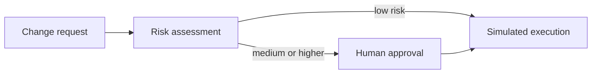

# Agentic Change Control

A high-governance LangGraph workflow for AI-assisted software change operations. It assesses risk, constrains the proposed action list with a fixed allowlist, interrupts for human approval, then calls a simulated idempotent executor. The agent cannot issue arbitrary shell commands or deploy to production.

## Workflow



## Run

```bash
python -m venv .venv && source .venv/bin/activate
pip install -e '.[test]'
uvicorn change_control.app:app --reload
```

Try `POST /changes` with `{"change_id":"demo-1","summary":"add unit tests","environment":"development","actions":["run_unit_tests"]}`. A staging or production request pauses for explicit approval; resume with `POST /changes/demo-2/approval`.

## Senior-level concerns demonstrated

- Policy-as-code separates risk decisions from LLM language generation.
- Tool permissions are allowlisted and unknown tools are rejected.
- Human approval is an explicit checkpoint, with a stable thread ID.
- Execution is simulated and idempotency keys are emitted for downstream adapters.
- Audit events capture assessment, approval, and execution.
- A production adapter would require signed webhook verification, durable encrypted checkpoints, scoped IAM, distributed idempotency, and deployment rollback.

## Tests

`pytest -q` verifies risk escalation, tool allowlisting, and that unsafe actions never enter the plan.
